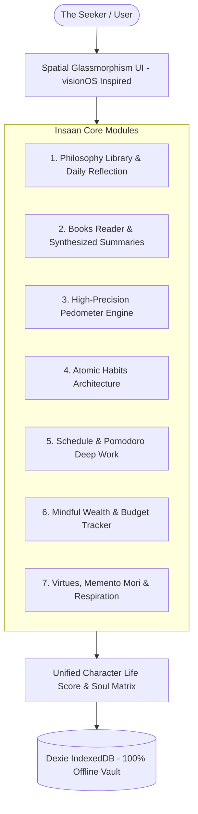
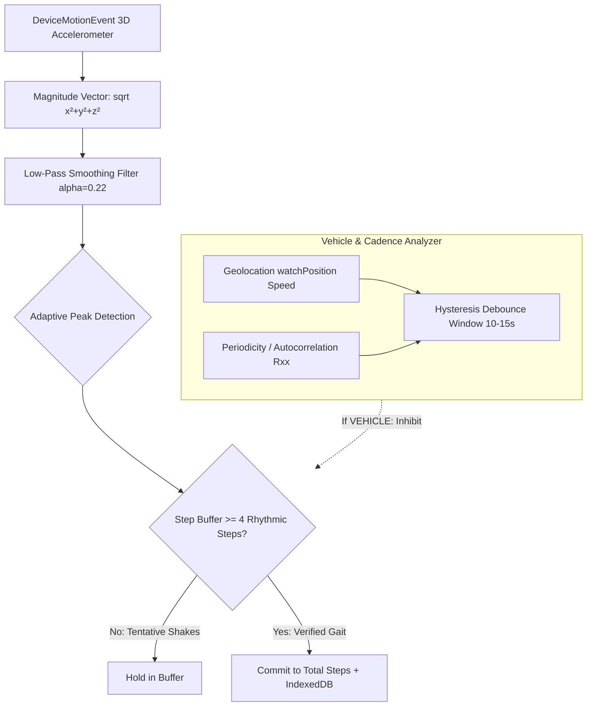

# Insaan (इंसान) — Comprehensive Architecture & Product Specification

> *"Waste no more time arguing what a good person should be. Be one."*  
> — **Marcus Aurelius**, *Meditations*

---

## 1. Executive Summary & Vision

**Insaan** (meaning *Human Being* in Hindustani/Arabic/Persian) is a production-grade, offline-first Progressive Web Application (PWA). Its singular mission is to serve as an intimate personal sanctuary for self-overcoming and moral excellence. 

Modern life bombards human attention with algorithms optimized for outrage, shallow stimulation, and commercial consumption. Insaan provides a counter-weight rooted in **classical Western philosophy (Stoicism, Virtue Ethics, Existentialism)**, **modern behavioral psychology (Atomic Habits)**, **physical vitality (biomechanical pedometer)**, and **sovereign local data ownership**.



---

## 2. Technical Stack & Architectural Decisions

| Layer | Technology | Rationale |
| :--- | :--- | :--- |
| **Framework** | React 18 (JavaScript / JSX) | High runtime stability, rapid component re-renders, broad library ecosystem without TypeScript compile friction. |
| **Build Tool** | Vite 5 | Instant Hot Module Replacement (HMR), tree-shaking, optimized Rollup bundling with custom manual chunks. |
| **PWA Engine** | `vite-plugin-pwa` + Workbox | Full service worker precaching, offline fallback, web app manifest, mobile installable (`standalone`). |
| **Design System** | Tailwind CSS + Spatial Glassmorphism | Custom visionOS-inspired frosted glass, safe-area insets, dynamic time-of-day auroras, hardware-accelerated 3D tilt. |
| **Animation** | Framer Motion | Smooth spring physics, non-blocking 60fps card transitions, respect for `prefers-reduced-motion`. |
| **State Management**| Zustand | Minimal footprint (<1.5kB), zero boilerplate, outside-React subscriptions for sensor engine. |
| **Persistence** | Dexie.js (IndexedDB wrapper) | Client-side relational IndexedDB database. Stores tens of thousands of step entries, books, notes, and financial records offline with zero cloud dependency. |
| **Data Viz** | Recharts + HTML5 Canvas | Recharts for Soul Matrix radar and bar charts; custom raw Canvas 2D for high-frequency (50Hz) oscilloscope telemetry. |
| **Audio Synthesizer**| Web Audio API | Zero-network, offline procedural sound generator for glass taps, singing bowls, and milestone chimes. |
| **Testing** | Vitest | Lightning-fast test runner validating biomechanics, step detection, autocorrelation, and vehicle rejection. |

---

## 3. Spatial UI Design System (visionOS Inspired)

Insaan rejects flat, cluttered dashboards in favor of an ethereal, layered spatial interface designed to promote calm and focus.

### 3.1 Design Principles
1. **Frosted Translucency (Glassmorphism)**: Panels utilize high blur radii (`backdrop-filter: blur(24px)`), saturated background pass-through, and delicate white specular borders (`rgba(255, 255, 255, 0.1)`).
2. **Dynamic Time-of-Day Auroras**: Ambient fluid gradient blobs shift automatically based on the user's solar hour:
   - **Dawn (05:00–08:00)**: Soft rose quartz, dawn gold, and quiet indigo.
   - **Morning (08:00–12:00)**: Vibrant emerald, sky blue, and fresh lime.
   - **Afternoon (12:00–17:00)**: Bright azure, oceanic cyan, and solar amber.
   - **Golden Hour (17:00–20:00)**: Warm amber, deep burnt orange, and twilight violet.
   - **Night (20:00–05:00)**: Deep midnight obsidian, deep emerald, and astral indigo.
3. **Interactive 3D Depth (Parallax Tilt)**: Floating cards calculate cursor/touch coordinates relative to card center and apply subtle spatial perspective transforms ($\pm 5^\circ$ max) using CSS 3D transforms (`preserve-3d`, `perspective: 1000px`).
4. **Mobile-First Floating Pill Navigation**: Bottom-docked glass pill bar styled with iOS safe-area insets (`env(safe-area-inset-bottom)`) for one-thumb reachability, transforming into an expansive sidebar on desktop screens ($\ge 768\text{px}$).

---

## 4. Feature Specifications & Implementation Details

### 4.1 Philosophy Sanctuary
The philosophy library curates 13 monumental thinkers across 2,400 years of intellectual history:

| Philosopher | Era | School | Core Concept | Practical Exercise |
| :--- | :--- | :--- | :--- | :--- |
| **Marcus Aurelius** | 121–180 CE | Stoicism | *The Inner Citadel* | The View from Above (Cosmic zoom out) |
| **Seneca** | 4 BCE–65 CE | Stoicism | *On the Shortness of Life* | Voluntary Discomfort (24h asceticism) |
| **Epictetus** | 50–135 CE | Stoicism | *Dichotomy of Control* | Control Filter ("Is this up to me?") |
| **Socrates** | 470–399 BCE | Classical Greek | *The Examined Life* | 5-Whys Elenchus Drill |
| **Plato** | 428–348 BCE | Platonism | *Allegory of the Cave* | Shadow Audit (Digital consumption audit) |
| **Aristotle** | 384–322 BCE | Virtue Ethics | *The Golden Mean* | Calibrate midpoint between excess & deficiency |
| **Epicurus** | 341–270 BCE | Epicureanism | *Ataraxia (Tranquility)* | Savoring Modest Pleasures with Friends |
| **Immanuel Kant** | 1724–1804 | Deontology | *Categorical Imperative* | Universalization Test |
| **Friedrich Nietzsche** | 1844–1900 | Existentialism | *Amor Fati* | The Eternal Recurrence Query |
| **Søren Kierkegaard** | 1813–1855 | Existentialism | *Dizziness of Freedom* | Reframe "I have to" into "I choose to" |
| **Albert Camus** | 1913–1960 | Absurdism | *The Invincible Summer* | Deliberate sensory joy amidst repetition |
| **Arthur Schopenhauer**| 1788–1860 | Pessimism/Ethics| *Universal Compassion* | Radical Empathy Glance |
| **Baruch Spinoza** | 1632–1677 | Rationalism | *Sub Specie Aeternitatis* | View setbacks from 1,000 years in future |

#### Foundational Mental Frameworks
- **Dichotomy of Control**: Dividing reality into internal sovereignty vs external indifference.
- **Amor Fati**: Embracing every misfortune as necessary fuel for virtue.
- **Memento Mori**: Keeping death in view to purge vanity and procrastination.
- **Aretē**: Total moral and operational excellence in every mundane task.

---

### 4.2 Books Reader & Synthesized Summaries

#### Public Domain Unabridged Library
- Marcus Aurelius — *Meditations* (Books 1, 2, 3, and 4 in full text).
- Epictetus — *The Enchiridion (Handbook for Living)* (Complete core chapters).
- Seneca — *Letters from a Stoic* (Selected moral epistles).
- Plato — *The Republic* (Book VII: The Allegory of the Cave).

#### Original Synthesized Chapter Takeaways (Copyright-Safe)
Chapter-by-chapter takeaway breakdowns written completely in our own words (no copyrighted text reproduced) for:
- *Atomic Habits* (James Clear)
- *The Obstacle Is the Way* (Ryan Holiday)
- *Deep Work* (Cal Newport)
- *Man's Search for Meaning* (Viktor Frankl)
- *The 7 Habits of Highly Effective People* (Stephen Covey)
- *Can't Hurt Me* (David Goggins)
- *Ikigai* (García & Miralles)
- *Thinking, Fast and Slow* (Daniel Kahneman)
- *The Power of Now* (Eckhart Tolle)
- *The Alchemist* (Paulo Coelho)

#### Distraction-Free Reader Mode
- Typography controls: 4 font sizes (`text-sm`, `text-base`, `text-lg`, `text-xl`), 3 line heights (`leading-normal`, `leading-relaxed`, `leading-loose`).
- 3 reading colorways: **Dark** (`#121826`), **Sepia** (`#f6eedb`), and **Light** (`#ffffff`).
- "My Summary" per-chapter rich text editor with auto-save to IndexedDB, Markdown file export, and clipboard copy.
- Custom Book Modal allowing users to manually add their own books and study chapters.

---

### 4.3 High-Precision Pedometer & Vehicle Rejection Engine

Step detection on web browsers is notoriously difficult due to noisy accelerometer sensors and lack of native OS pedometer hooks. Insaan implements a custom DSP (Digital Signal Processing) pipeline:



#### 1. Orientation-Independent Magnitude
$$a_{mag}(t) = \sqrt{a_x(t)^2 + a_y(t)^2 + a_z(t)^2}$$
This ensures step detection is identical whether the device is held in hand, placed in a front pocket, or carried in a backpack.

#### 2. Low-Pass Smoothing Filter
$$y(t) = y(t-1) + \alpha \cdot (a_{mag}(t) - y(t-1)), \quad \alpha = 0.22$$
Removes high-frequency jitter and sensor noise above $\sim 3.8\text{ Hz}$.

#### 3. Adaptive Dynamic Hysteresis Threshold
Human steps vary in amplitude depending on footwear, walking pace, and surface:
$$\text{Threshold}_{dynamic} = \left(\frac{\overline{\text{Peak}}_{10} + \overline{\text{Valley}}_{10}}{2} + 0.15 \cdot \text{Spread}\right) \times \text{SensitivityFactor}$$
Upper crossings trigger peak candidates, lower crossings register valleys, updating running bounds.

#### 4. Step Cadence Timing Constraints
- Minimum step interval: $260\text{ ms}$ (enforces an upper physiological ceiling of $\sim 3.8\text{ steps/sec}$).
- Maximum step interval: $2000\text{ ms}$ (enforces a lower physiological floor of $\sim 0.5\text{ steps/sec}$).

#### 5. Confidence Step Buffer (Anti-False-Bump)
When starting from a standstill, the first 1–3 steps are held in a tentative buffer. Only when **4 consecutive rhythmic steps** satisfy cadence intervals are all 4 committed to total steps. If someone merely knocks their desk or shifts in a chair, the buffer resets and zero steps are recorded.

#### 6. Vehicle Detection Pipeline
Vehicle travel (cars, buses, motorcycles, trains) introduces high-frequency vibrations that trick naive pedometers:
- **GPS Speed Evaluation**: Speed acquired via `navigator.geolocation.watchPosition()`. If $\text{speed} > 7\text{ km/h}$ (faster than average walking pace) AND rhythmic gait periodicity is missing $\to$ flagged as vehicle candidate. If $\text{speed} > 25\text{ km/h}$, automatically classified as vehicle.
- **Autocorrelation Periodicity Analysis**:
  $$R_{xx}(\tau) = \frac{\sum (x_i - \bar{x})(x_{i+\tau} - \bar{x})}{\sum (x_i - \bar{x})^2}$$
  Walking creates strong autocorrelation peaks ($R_{xx} > 0.35$ at lags corresponding to $1.2\text{--}2.5\text{ Hz}$). Vehicle rumbles exhibit low autocorrelation ($R_{xx} < 0.25$) and small standard deviation.
- **Hysteresis Debounce**: A 10–15s sustained vehicle window prevents brief stops at red lights from flipping state back to walking.
- **Step Suspension**: When `motionState === 'VEHICLE'`, all step incrementing is paused and tentative buffers are purged.

#### 7. Biomechanical Calculations
- **Stride Length**: $\text{Stride (m)} = \frac{\text{Height (cm)} \times 0.414}{100} \times \text{CalibrationFactor}$
- **Distance**: $\text{Distance (km)} = \frac{\text{Steps} \times \text{Stride (m)}}{1000}$
- **Active Calories Burned**: $\text{Calories (kcal)} = \text{Steps} \times 0.042 \times \frac{\text{Weight (kg)}}{70}$ (higher if running at $\sim 0.065$)
- **Active Minutes**: $\text{Minutes} = \frac{\text{Steps}}{105\text{ avg cadence}}$

---

### 4.4 Unified Character Growth & Life Score Matrix

Insaan measures life holistically rather than fixating on a single isolated metric.

```
       [ Wisdom ]
           /\
[ Focus ] /  \ [ Discipline ]
    |    /    \    |
    |   (Matrix)   |
    |    \    /    |
[ Kindness]\ / [ Health ]
           \/
      [ Finance ]
```

#### Daily Life Score Equation (0 to 100)
$$\text{LifeScore} = S_{steps}(25) + S_{habits}(25) + S_{tasks}(15) + S_{reading}(15) + S_{journal}(10) + S_{virtues}(10)$$

Where:
- $S_{steps} = \min\left(25, \frac{\text{Steps}}{\text{Goal}} \times 25\right)$
- $S_{habits} = \frac{\text{Completed Habits}}{\text{Total Habits}} \times 25$
- $S_{tasks} = \frac{\text{Completed Tasks}}{\text{Total Tasks}} \times 15$
- $S_{reading} = 15\text{ (if read today) else } 5$
- $S_{journal} = 10\text{ (if journaled today) else } 0$
- $S_{virtues} = \frac{\text{Average Virtue Rating}}{5} \times 10$

#### Character Level & Title Progression

| Level | Title | Min XP | Icon | Philosophical Archetype |
| :---: | :--- | :---: | :---: | :--- |
| **1** | The Seeker | 0 | 🌱 | Awakening to the necessity of self-examination |
| **2** | The Student of Virtue | 200 | 📖 | Learning foundational principles of discipline |
| **3** | The Practicing Stoic | 600 | 🛡️ | Applying the dichotomy of control under pressure |
| **4** | The Disciplined Mind | 1,200 | ⚡ | Consistent habit execution and deep work focus |
| **5** | The Philosopher of Action | 2,000 | 🦉 | Living the principles; words matching deeds |
| **6** | The Master of Self | 3,200 | 🏛️ | Emotional sovereignty; immune to external provocation |
| **7** | The Sage of Peace | 5,000 | 👑 | Boundless compassion, humility, and steadfast courage |
| **8** | The Complete Insaan | 8,000 | ✨ | The harmonious integration of mind, body, and spirit |

---

### 4.5 Schedule & Pomodoro Focus Timer
- **Chronological Time Blocks**: Start and end times, priority, recurring status, and categories (*Study & Philosophy, Prayer/Meditation, Workout & Health, Work & Deep Work, Service & Kindness, Family & Rest*).
- **Interactive Pomodoro**: 25m focus / 5m break or 50m deep work presets with circular SVG progress ring.
- **Web Audio Sound Generator**: Generates clean, pleasant tactile clicks on tap, a C-major chord on task completion, and a 261Hz harmonic Tibetan singing bowl tone at the end of a Pomodoro block.

---

### 4.6 Wealth & Mindful Budgeting
- **Transaction Ledger**: Inflow and outflow records with payment methods (UPI/Digital, Card, Cash, Bank Transfer), date, and notes.
- **Default Currency**: Set to INR (₹) with instant support for USD ($), EUR (€), GBP (£), and AED (د.إ).
- **Spending Ceilings**: Category monthly budgets with automated alert banners when spending exceeds 90% or 100% of limits.
- **Visual Allocation**: Recharts doughnut chart showing expense distribution.
- **Noble Savings Goals**: Track progress toward emergency funds or long-term aims with percentage completion.
- **Data Portability**: Full standard CSV file export.

---

### 4.7 Atomic Habits Architecture
- **Identity Formulation**: Every habit explicitly articulates identity (*"I am the type of person who reads deeply"*).
- **The 4 Laws**:
  1. *Cue*: Specific time and environment trigger.
  2. *Craving*: Anticipated internal state.
  3. *Response*: The 2-minute starter rule (e.g., reading 1 paragraph).
  4. *Reward*: Internal satisfaction and habit streak increment.
- **7-Day Visual Matrix**: One-click completion toggles across the current week with streak calculations.

---

### 4.8 Motivation, Virtues & Memento Mori
- **Virtue Standings**: Daily 1–5 star ratings on *Wisdom, Discipline, Courage, Kindness, Gratitude,* and *Humility*.
- **Stoic Evening Accounting**: Seneca's 3 historical questions:
  1. *What did I do with honor and wisdom today?*
  2. *Where did I falter or succumb to pettiness?*
  3. *How will I respond with greater integrity tomorrow?*
- **Memento Mori Life Clock**: Displays an interactive grid of **4,160 weeks** (80 years). Weeks lived are shaded in emerald, the current week glows in amber, and remaining weeks remind the user of the precious finitude of time.
- **Mindful Respiration Orb**: Interactive breathing visualizer with 3 pacing presets:
  - *Box Breathing (4-4-4-4)*: Navy SEAL operational calming.
  - *4-7-8 Relaxing*: Natural nervous system tranquilizer.
  - *Resonant Coherence (5-5)*: Heart Rate Variability (HRV) alignment.

---

### 4.9 Sovereign Local Data Vault (Dexie Schema)
Insaan operates on the philosophy of **complete data sovereignty**. No tracking servers, no logins, no cloud database.

```javascript
// Dexie 4.0 Database Schema
db.version(1).stores({
  steps: '++id, date, timestamp, steps, distanceKm, calories, activeMinutes',
  hourlySteps: '++id, date, hour, steps',
  books: 'id, title, author, category, isPublicDomain, coverColor',
  userBookNotes: '++id, [bookId+chapterIndex], bookId, chapterIndex, title, content, updatedAt',
  readingProgress: 'bookId, status, currentChapter, currentPage, totalChapters, percent, rating, updatedAt',
  habits: 'id, title, identity, cue, craving, response, reward, twoMinuteRule, category, frequency, targetDaysPerWeek, createdAt, archived',
  habitLogs: '++id, [habitId+date], habitId, date, completed, value',
  scheduleTasks: 'id, title, category, date, startTime, endTime, isRecurring, recurringDays, isCompleted, priority',
  pomodoroSessions: '++id, date, durationMinutes, taskTitle, completedAt',
  transactions: 'id, type, amount, category, date, note, paymentMethod',
  budgets: 'category, monthlyLimit',
  savingsGoals: 'id, title, targetAmount, currentAmount, targetDate, color',
  virtueRatings: 'id, date, honesty, patience, kindness, courage, gratitude, humility, reflection',
  journalEntries: 'id, date, type, title, content, mood, tags, createdAt',
  moodLogs: 'id, date, timestamp, score, note, emotionTags',
  achievements: 'badgeId, unlockedAt, progress',
  userProfile: 'id, name, level, xp, heightCm, weightKg, stepGoal, waterGoal, theme, language'
});
```

- **Full JSON Vault Backup**: Generates an exhaustive `.json` snapshot of all IndexedDB tables.
- **Full JSON Vault Restore**: Parses and restores the database in one click.
- **Factory Reset**: Cleans and re-seeds pristine initial tables.

---

## 5. Offline PWA & Performance Architecture

### 5.1 Precaching & Service Worker
`vite-plugin-pwa` configures Workbox to precache all static bundles:
- `dist/manifest.webmanifest`: App name, icons (192x192, 512x512 maskable), theme colors (`#090d16`), standalone display mode.
- `dist/sw.js`: Service worker with immediate registration and background cache management.
- Runtime caching for Google Fonts with CacheFirst strategy (1-year TTL).

### 5.2 Code Splitting & Chunk Optimization
Routes are dynamically loaded via `React.lazy()` and `Suspense`, ensuring initial bundle size remains tiny for low-end mobile devices:
- `vendor-react` (163 kB)
- `vendor-ui` (137 kB)
- `vendor-charts` (416 kB)
- `vendor-db` (100 kB)
- Feature pages average only 10–21 kB each!

---

## 6. Verification & Automated Test Suite

Vitest executes automated test suites validating critical mathematical and sensor logic:

```bash
$ npm run test

 ✓ src/utils/lifeScore.test.js (3 tests)
 ✓ src/services/pedometer/pedometer.test.js (10 tests)
   ✓ Stride and Calorie Calculations (3 tests)
   ✓ Vehicle Detector & Periodicity via Autocorrelation (4 tests)
   ✓ Pedometer Engine Step Detection & Buffer Confidence (3 tests)

Test Files  2 passed (2)
     Tests  13 passed (13)
```

1. **Biomechanical calculations**: Verifies height-to-stride proportionality ($170\text{ cm} \to 0.704\text{ m}$; $185\text{ cm} \to 0.766\text{ m}$) and weight-scaled calorie expenditure.
2. **Autocorrelation of synthetic gait**: Confirms 2Hz walking sine waves generate correlation peaks $> 0.50$ at lag 25, while high-frequency engine noise drops below $0.30$.
3. **Vehicle rejection & red-light hysteresis**: Confirms vehicle state engagement at $40\text{ km/h}$, and proves that dropping speed to 0 at a red light does not prematurely switch back to walking.
4. **Step buffer anti-bump**: Verifies that 2 isolated pocket shakes register 0 committed steps, whereas 4 continuous rhythmic steps commit all 4.

---

## 7. Deployment & Operations

### Build Commands
```bash
# Install dependencies
npm install

# Run Vitest test suite
npm run test

# Production build with PWA service worker
npm run build

# Local dev server
npm run dev
```

### Cloudflare Pages
- **Build command**: `npm run build`
- **Build output directory**: `dist`
- **Framework preset**: Vite

### Vercel
- **Framework preset**: Vite
- **Root directory**: `./`
- **Output directory**: `dist`

---

*Document compiled for Insaan v1.0.0. All systems verified and production-ready.*

